## 功能点明细

### 4.1 认证与账户（`AU-NN`，9 项）

| ID | 功能点 | 入口 / 宿主 | 说明与截图要点 | 补图 | 截图 |
|---|---|---|---|:---:|---|
| AU-01 | 登录页 | `/login` | 账号密码登录、第三方登录入口、忘记密码入口 · 截图：登录表单与品牌视频背景 | [ ] |  |
| AU-02 | 注册页 | `/register` | 邮箱/验证码注册，含频控倒计时与防重复提交 · 截图：注册表单与验证码位 | [ ] | 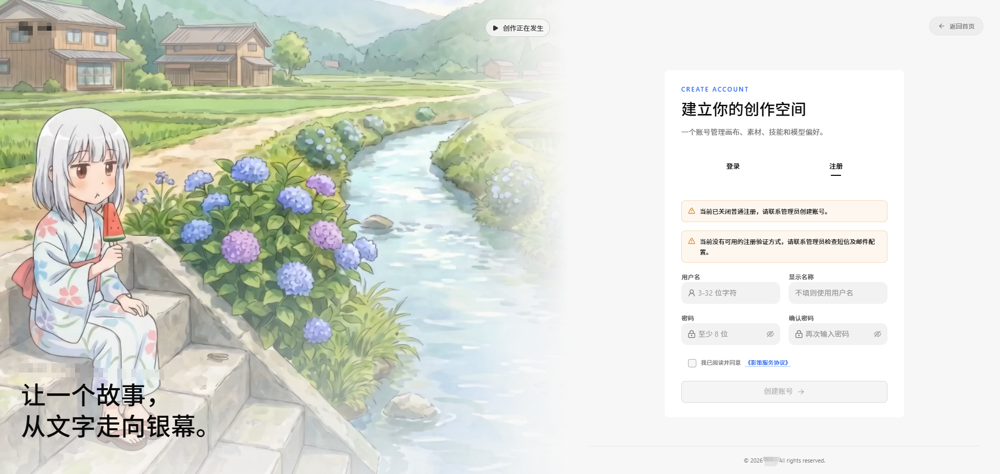 |
| AU-03 | 找回密码 | `/forgot-password` | 邮箱验证码两阶段重置密码 · 截图：验证码输入 + 新密码两步表单 | [ ] |  |
| AU-04 | 登录场景外壳 | `AuthScene`（`/login` 等） | 品牌主标题、视频/封面、版权与 ICP 备案页脚 · 截图：公共登录场景整屏 | [ ] | 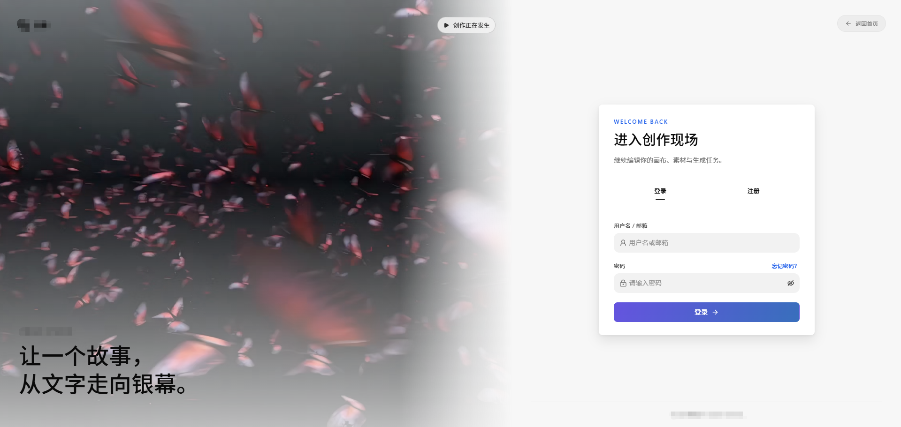 |
| AU-05 | 个人信息 | `/settings?section=profile` | 账号名称、绑定邮箱状态、头像/密码/邮箱维护 · 截图：个人信息分区 | [ ] | 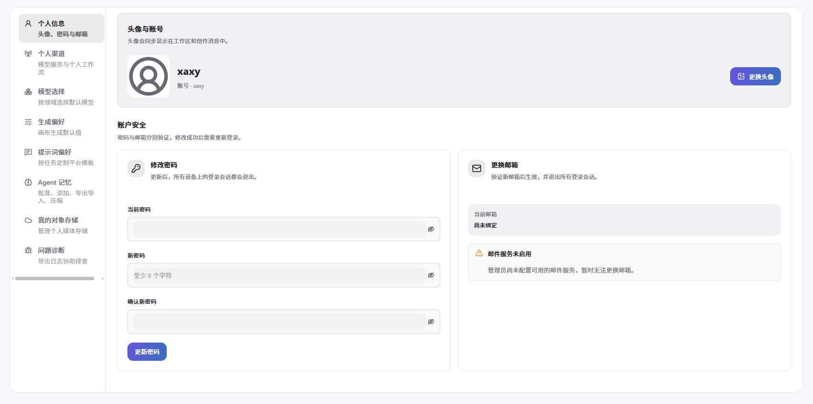 |
| AU-06 | 更换头像弹窗 | 个人信息 → 更换头像 | 上传图 1:1 裁剪 + 8 款系统头像，弹窗内保存 · 截图：头像弹窗与裁剪框 | [ ] | 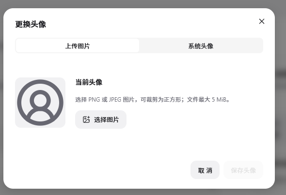 |
| AU-07 | 密码修改与邮箱更换 | 个人信息分区表单 | 需当前密码；换邮箱需验证码并踢出全部会话 · 截图：两组表单与保存反馈 | [ ] | 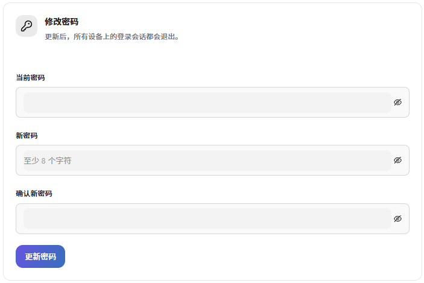 |
| AU-08 | 用户登录日志 | `/admin/login-logs` | 成功/失败登录、注册自动登录、主动退出，多维筛选 · 截图：日志表格 | [ ] | 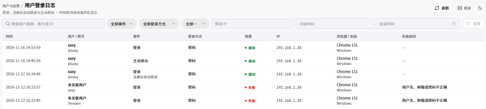 |
| AU-09 | 登录日志详情抽屉 | 日志行 → 详情 | 账号快照、设备信息、安全原因、失败重试 · 截图：右侧详情抽屉 | [ ] | 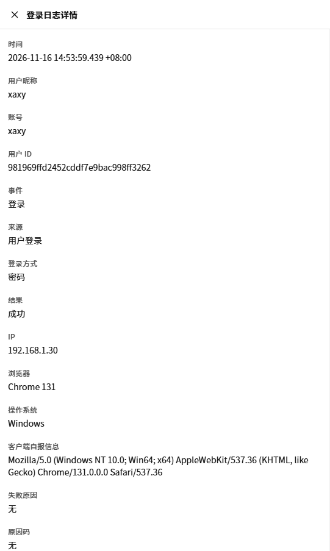 |

### 4.2 创作首页与灵感（`HM-NN`，15 项）

| ID | 功能点 | 入口 / 宿主 | 说明与截图要点 | 补图 | 截图 |
|---|---|---|---|:---:|---|
| HM-01 | 创作首页 | `/`、`/create` | 空态首屏、紧凑标题、提示词输入与快捷创作 · 截图：首页首屏全貌 | [ ] | 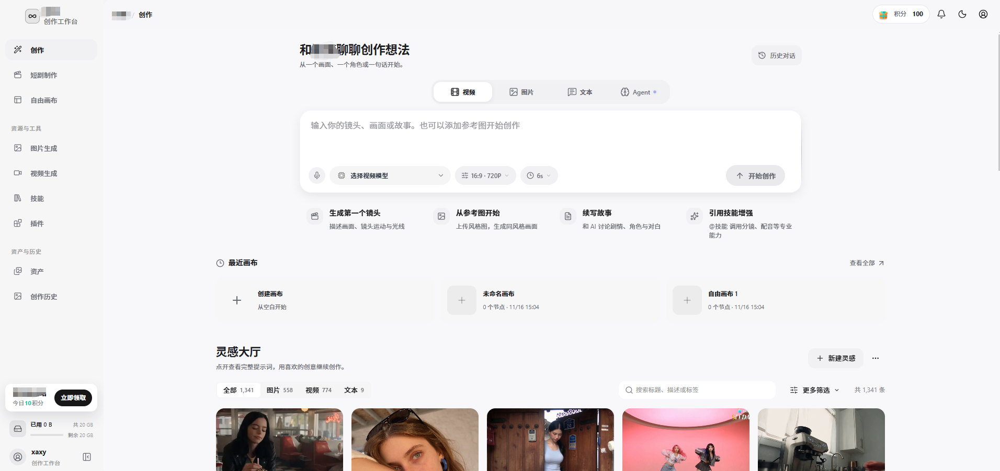 |
| HM-02 | 创作模式切换 | 首页模式 Tabs | 文本/图片/视频 + Agent 模式切换 · 截图：模式胶囊标签栏 | [ ] | 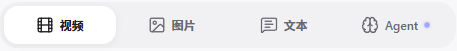 |
| HM-03 | 首页参考图与生成结果 | 首页输入区 | 参考图槽位、结果卡片、会话消息 · 截图：输入区含参考图缩略 | [ ] | 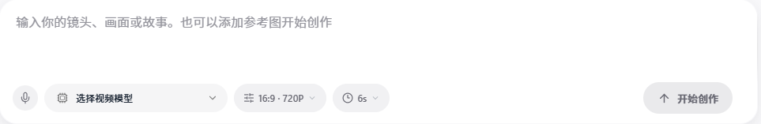 |
| HM-04 | 首页 Agent 模式 | 首页 Agent Tab | 会话式规划、方案/报价确认后落地画布 · 截图：Agent 模式输入区 | [ ] | 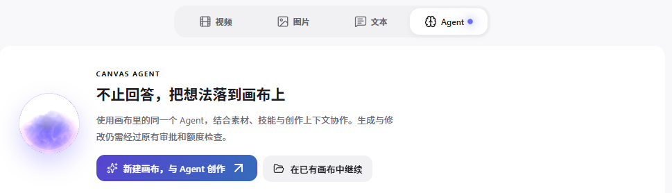 |
| HM-05 | 最近画布 | 首页下方一行 | 4 个最近画布、创建画布、查看全部、窄屏横滑 · 截图：最近画布卡片行 | [ ] | 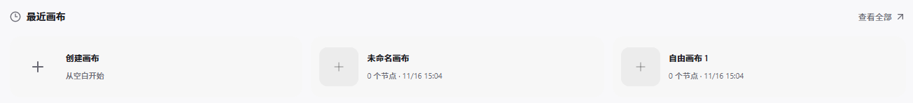 |
| HM-06 | 灵感大厅 | 首页内嵌（无 `/inspirations` 路由） | 类型/搜索常驻，来源/分类/收藏/隐藏/排序收进更多筛选 · 截图：灵感卡片墙与筛选栏 | [ ] |  |
| HM-07 | 灵感详情弹窗 | 灵感卡片 → 查看 | 中文正文、复制、回填创作、关闭详情 · 截图：详情弹窗 | [ ] |  |
| HM-08 | 灵感新建/编辑弹窗 | 灵感大厅 → 新建灵感 / 编辑 | 自建条目编辑、隐藏恢复、收藏 · 截图：编辑表单弹窗 | [ ] | 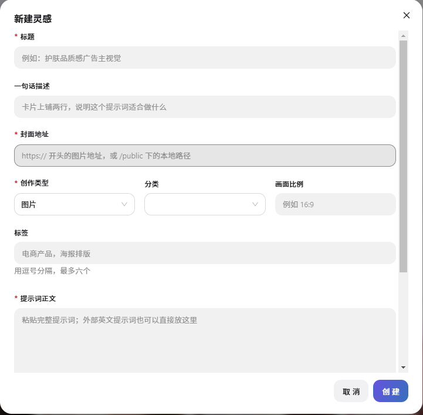 |
| HM-09 | 灵感导入导出 | 更多操作菜单 | JSON 导入/导出本地改动 · 截图：下拉菜单与导入结果提示 | [ ] | 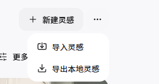 |
| HM-10 | 首页图片预览 | 生成结果/参考图/故事板 → 点击 | 复用画布全屏查看器，缩放 0.5–12、移动关闭 · 截图：全屏图片查看器 | [ ] |  |
| HM-11 | 首页视频预览弹窗 | 首页视频结果 → 点击 | 创作页原有视频播放弹窗 · 截图：视频播放弹窗 | [ ] | 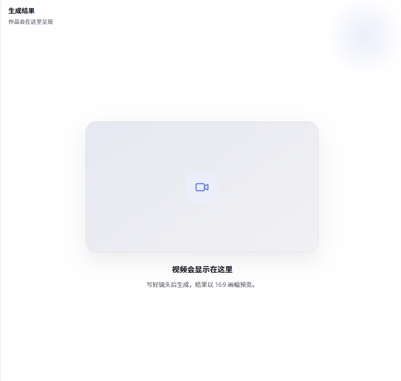 |
| HM-12 | 首页常驻滚动通知条 | 首页顶部 | 运营配置的公告/活动/更新/警告轮播，可本地关闭 · 截图：顶部通知条 | [ ] | 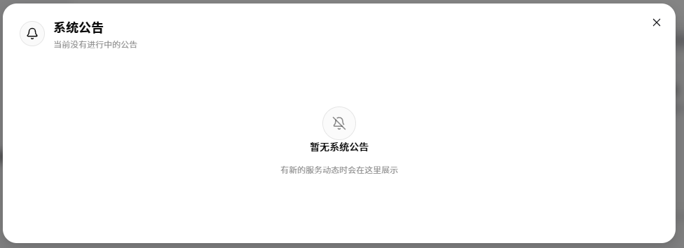 |
| HM-13 | 签到加油站 | 侧栏容量条上方 | 每日签到积分卡片，领取后消失 · 截图：侧栏领取卡片 | [ ] | 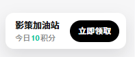 |
| HM-14 | 账号文件容量 | 侧栏左下角 | 已用/剩余容量进度，70%/90% 变色，点击进入素材库 · 截图：容量进度条 | [ ] | 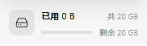 |
| HM-15 | 账户卡片菜单 | 侧栏头像点击 | 余额、账户与设置、管理员后台、退出登录 · 截图：弹出账户卡片 | [ ] | 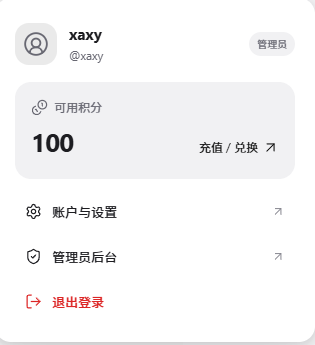 |

### 4.3 画布核心（`CV-NN`，25 项）

| ID | 功能点 | 入口 / 宿主 | 说明与截图要点 | 补图 | 截图 |
|---|---|---|---|:---:|---|
| CV-01 | 画布列表页 | `/canvas` | 搜索、排序、项目筛选、分页、新建/导入/批量删除 · 截图：画布卡片网格与工具栏 | [ ] | 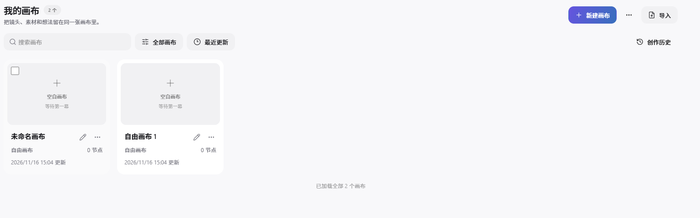 |
| CV-02 | 画布卡片与文件夹卡片 | 列表卡片菜单 | 预览、重命名、关联项目、导出画布、删除 · 截图：卡片悬停菜单 | [ ] | 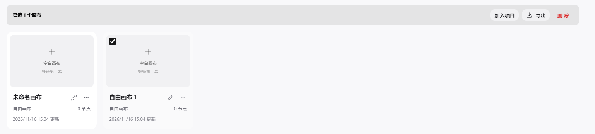 |
| CV-03 | 画布编辑器 | `/canvas/:id` | 无限画布、顶栏、底部工具栏、节点与连线 · 截图：编辑器整屏 | [ ] | 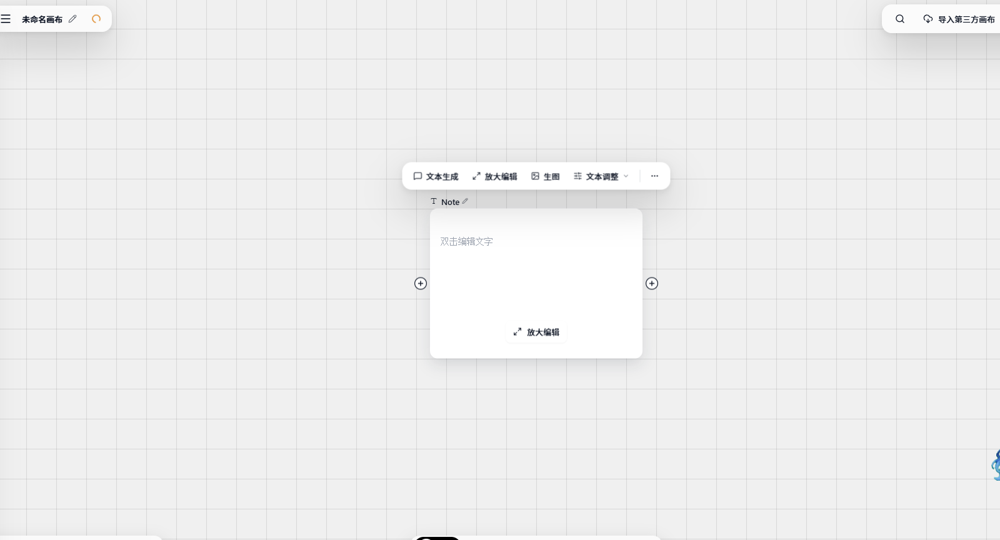 |
| CV-04 | 画布顶栏菜单 | 顶栏汉堡按钮 | 主页/画布、新建/删除/保存、导入、搜索节点、撤销重做 · 截图：展开的顶栏下拉 | [ ] | 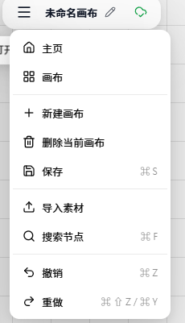 |
| CV-05 | 空白画布起点 | 新建空画布 | 「从哪里开始」引导 + 中央加号起始框，选自由空白画布 · 截图：空画布引导卡 | [ ] | 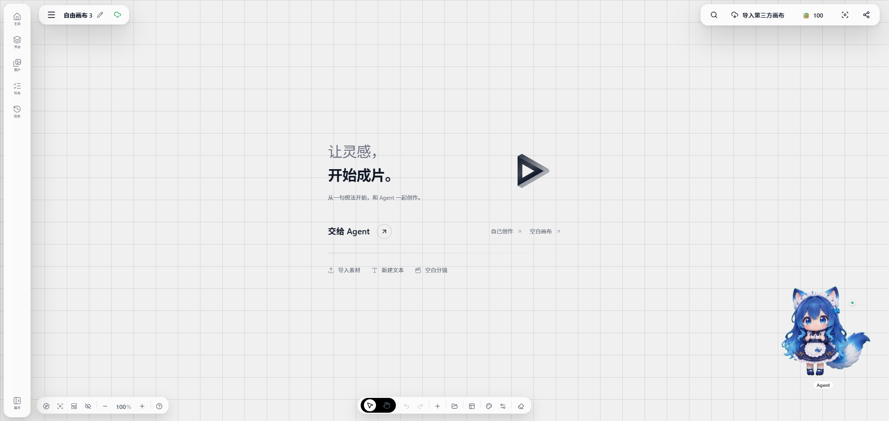 |
| CV-06 | 添加节点菜单 | 底部「+」或中央加号 | 项目画风/节点/工作流/资源四分区，含预演台、上传、素材库 · 截图：添加节点面板 | [ ] | 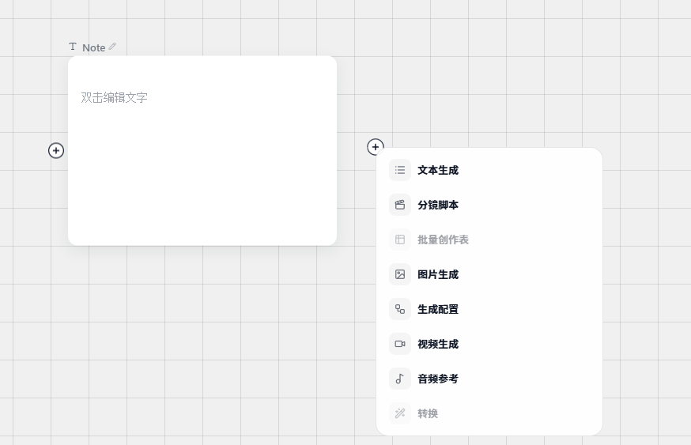 |
| CV-07 | 文本节点 | 添加节点 → 文本 | 富文本/放大编辑、字号随尺寸联动、生图、字号调整 · 截图：文本节点与悬浮工具 | [ ] | 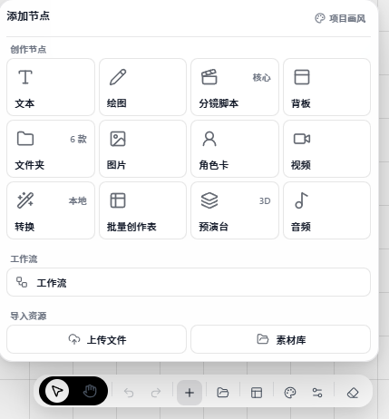 |
| CV-08 | 图片节点 | 添加节点 → 图片 | 上传/生成、提示词面板、图片工具栏、预览 · 截图：图片节点与工具栏 | [ ] | 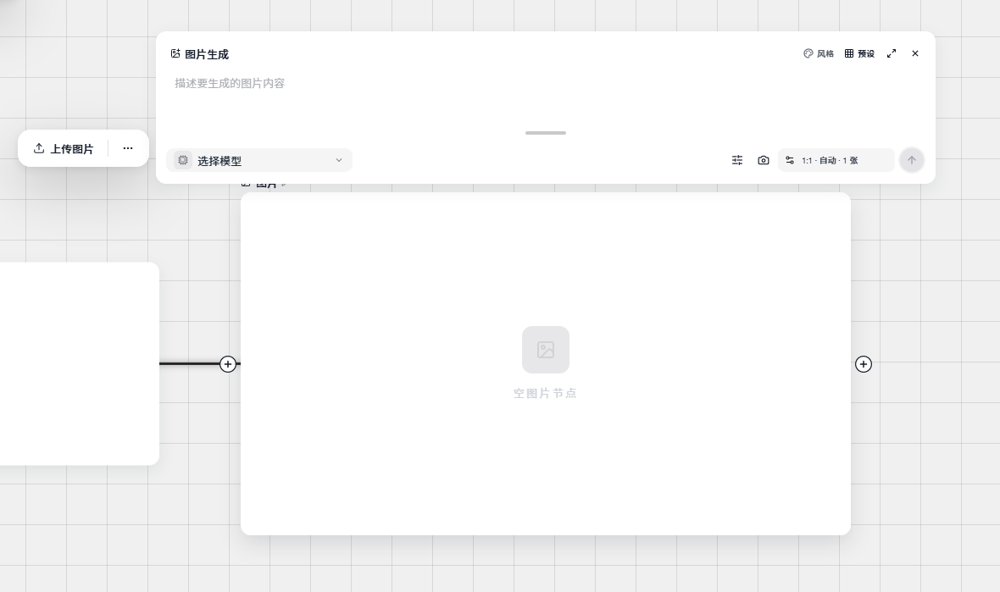 |
| CV-09 | 视频节点 | 添加节点 → 视频 | 上传/生成、悬停静音预览、字幕、时间线编辑入口 · 截图：视频节点与悬浮工具 | [ ] | 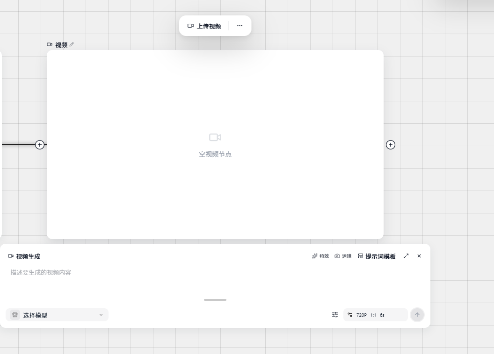 |
| CV-10 | 音频节点 | 添加节点 → 音频 | 上传/替换、波形播放、下载 · 截图：音频节点与播放器 | [ ] | 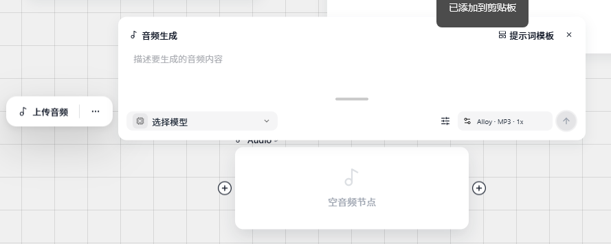 |
| CV-11 | 分镜脚本节点 | 添加节点 → 分镜脚本 | 逐镜表格（时长/描述/对白/运镜）、添加镜头、全屏编辑 · 截图：分镜表节点 | [ ] | 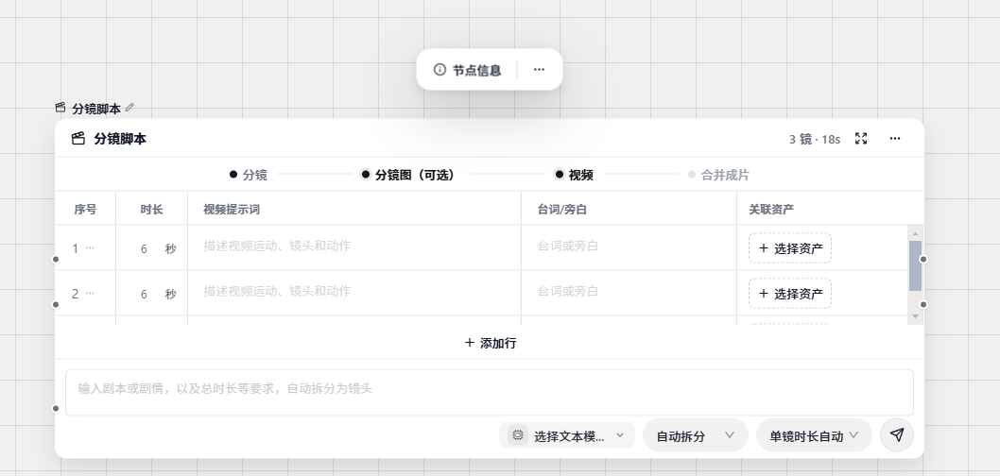 |
| CV-12 | 批量创作表节点 | 添加节点 → 批量创作表 | 行任务 × 参考图格、全局提示词、按列填充、放大编辑 · 截图：批量表节点 | [ ] | 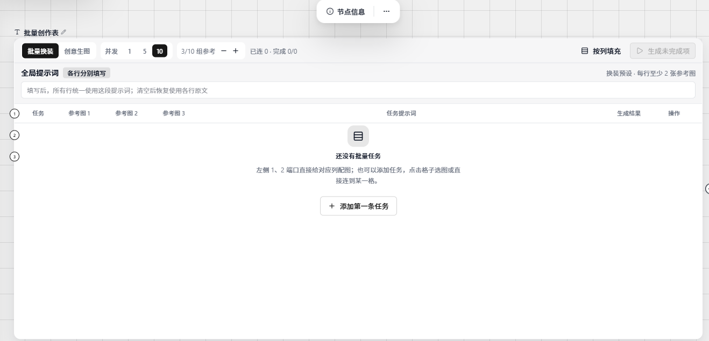 |
| CV-13 | 绘图节点编辑器 | 添加节点 → 绘图 | Excalidraw / tldraw / Leafer 绘图弹窗 · 截图：绘图编辑弹窗 | [ ] | 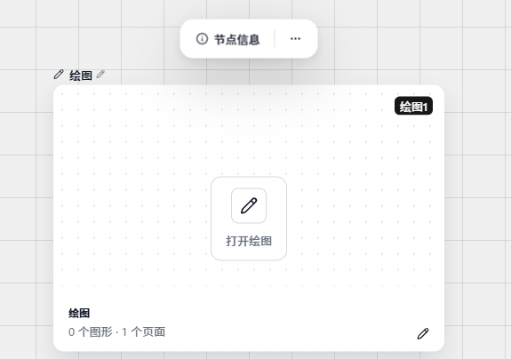 |
| CV-14 | 对比节点 / 媒体转换节点 | 添加节点 → 对比 / 转换 | A-B 对比查看；图片视频本地格式转换 · 截图：对比节点或转换节点 | [ ] | 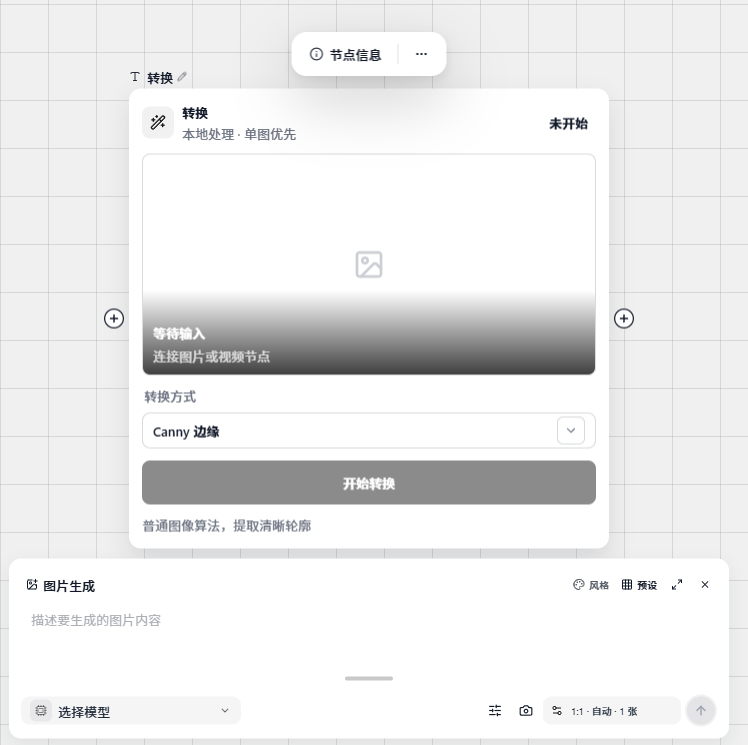 |
| CV-15 | 背板 / 文件夹 / 角色卡 / 工作流 / 全景 | 添加节点菜单 | 容器、分组、角色卡、生成配置、360° 全景节点 · 截图：混合节点画布 | [ ] | 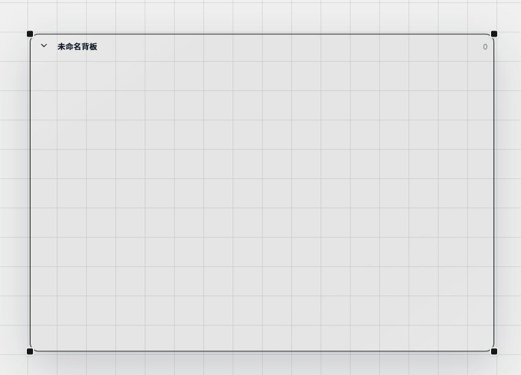 |
| CV-16 | 节点连线 | 节点端口拖拽 | 连线创建、批量连接、隐藏连线开关（按浏览器保存） · 截图：连线与节点端口 | [ ] | 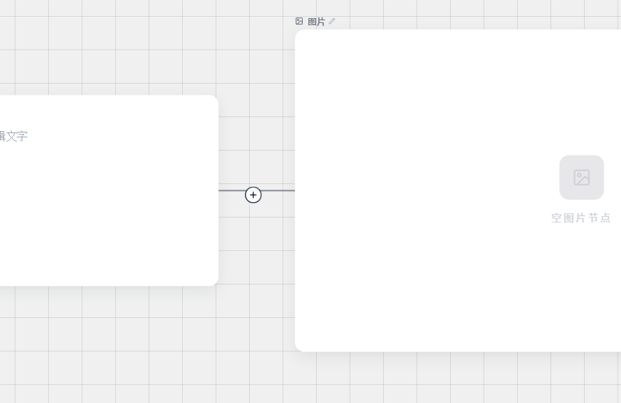 |
| CV-17 | 区域选择 / 抓手胶囊开关 | 底部主工具栏 | 空白处框选 vs 抓手平移，空格/中键临时平移 · 截图：底部胶囊滑块 | [ ] | 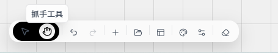 |
| CV-18 | 视图控制 Dock | 画布左下角 | 精确缩放、适应画布、小地图、自动整理节点、隐藏节点连线 · 截图：缩放控件与小地图 | [ ] | 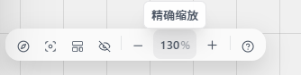 |
| CV-19 | 多选悬浮栏 | 框选 ≥2 节点 | 对齐/等距/创建分镜组/批量连接/合并视频/发送到 Agent · 截图：选区上方悬浮栏 | [ ] | 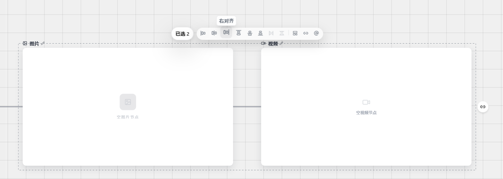 |
| CV-20 | 画布右键菜单 | 画布空白/选区右键 | 粘贴、自适应整理画布（保持相对布局加大边距） · 截图：右键上下文菜单 | [ ] | 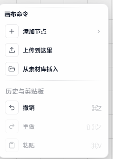 |
| CV-21 | 画布快捷键弹窗 | 顶栏 `?` / 快捷键 | 分类检索键盘、鼠标、视图快捷键 · 截图：快捷键弹窗 | [ ] | 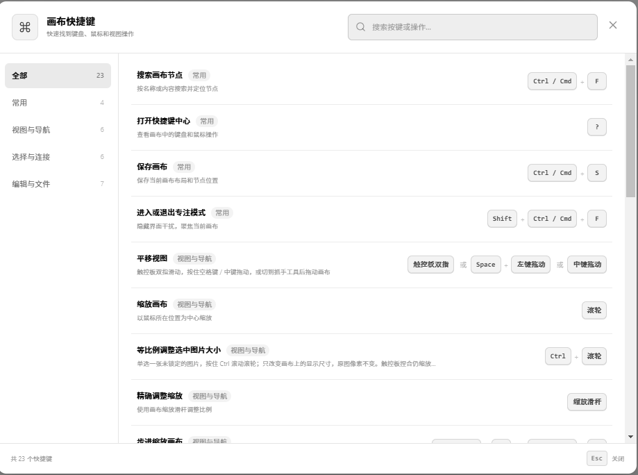 |
| CV-22 | 全局节点搜索 | 顶栏搜索 / ⌘F | 搜节点、章节、镜头、模型、标签并定位 · 截图：搜索结果弹窗 | [ ] | 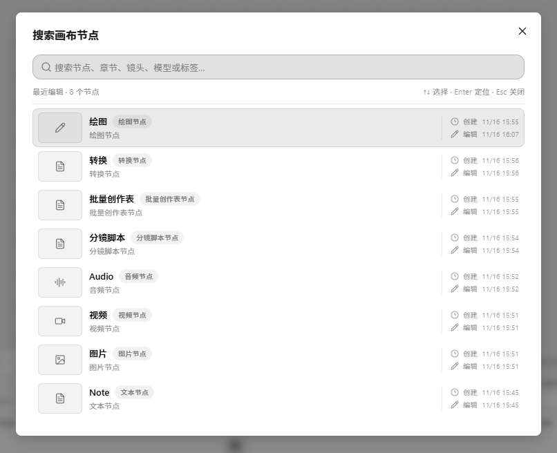 |
| CV-23 | 双击新建与拖入文件 | 画布空白处双击 / 文件拖入 | 双击打开添加菜单；拖拽显示上传浮层并生成节点 · 截图：拖放覆盖层 | [ ] | 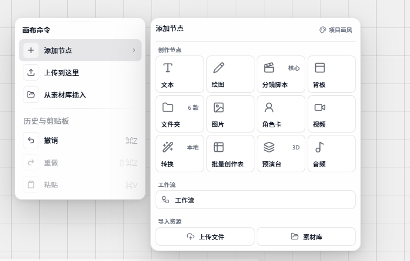 |
| CV-24 | 画布外观面板 | 底部「画布外观」 | 浅/深/自定义主题、点阵/线稿/空白网格、预设与颜色微调 · 截图：外观面板展开 | [ ] | 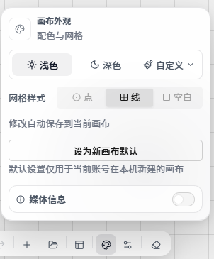 |
| CV-25 | 多窗口协作指示 | 画布顶部正中 | 在线设备数、远端光标与拖拽轮廓 · 截图：顶部协作气泡 | 暂无 |                                     |

### 4.4 画布创作工具（`CT-NN`，24 项）

| ID | 功能点 | 入口 / 宿主 | 说明与截图要点 | 补图 | 截图 |
|---|---|---|---|:---:|---|
| CT-01 | 节点提示词与模型面板 | 图片/视频节点 → 生成设置 | 提示词、模型下拉、参数、参考素材、生成按钮 · 截图：节点提示词面板 | [ ] | 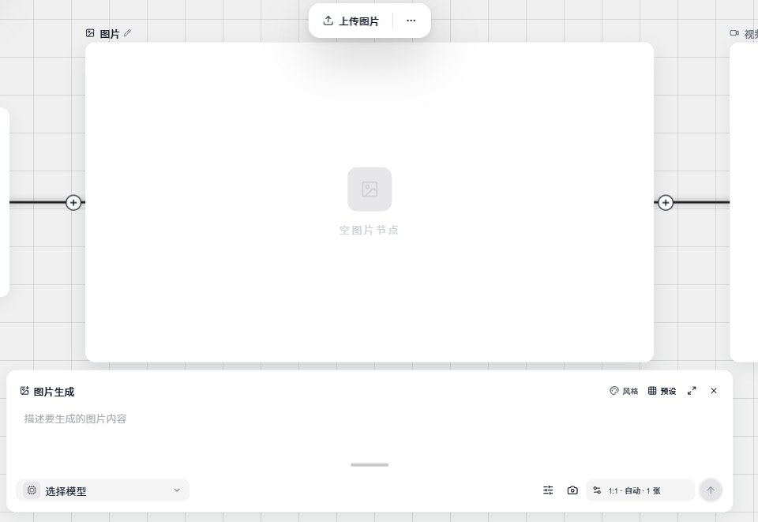 |
| CT-02 | 局部重绘 | 图片工具 → 局部重绘 | 涂抹蒙版区域后生成新图 · 截图：蒙版编辑弹窗 | [ ] | 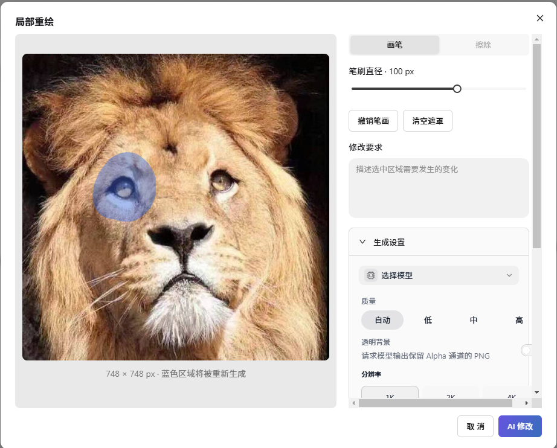 |
| CT-03 | 去除背景 / 文字编辑 / 标注编辑 | 图片工具菜单 | 抠图透明输出、识别改字、画笔标记改图 · 截图：工具菜单展开 | [ ] | 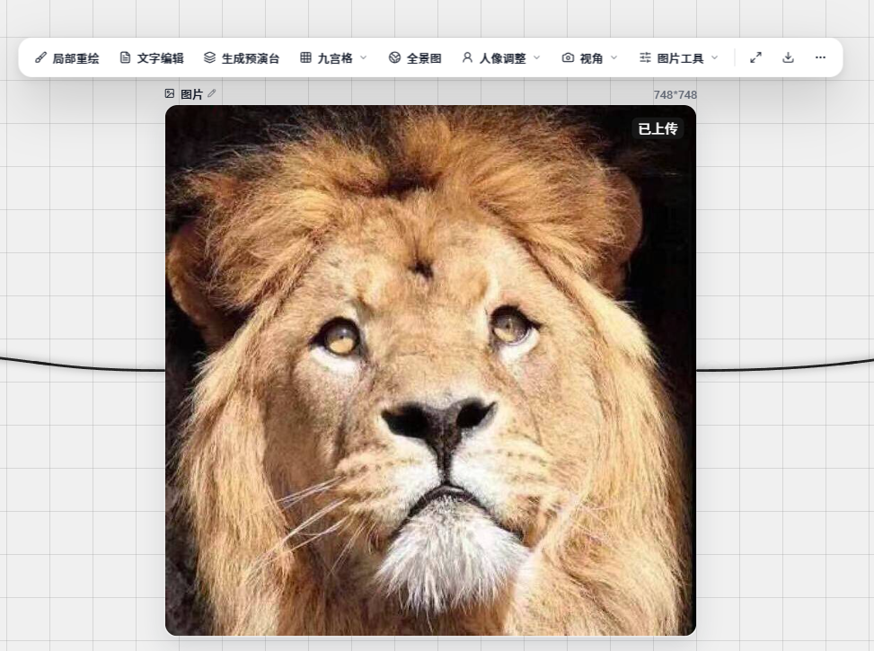 |
| CT-04 | 打光 | 图片工具 → 打光 | 光线方向、亮度、光效调整后生成 · 截图：打光参数弹窗 | [ ] | 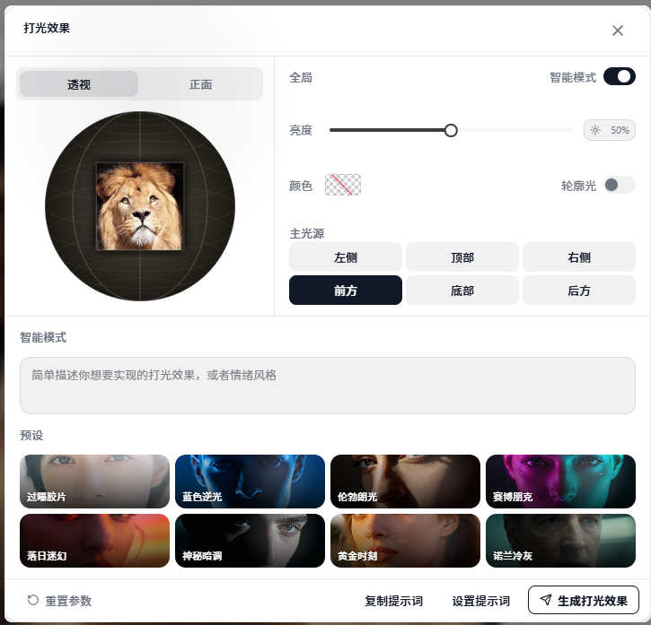 |
| CT-05 | 多角度 | 图片工具 → 多角度 | 节点下方 3D 天空盒/机位/方向箭头 · 截图：多角度面板 | [ ] | 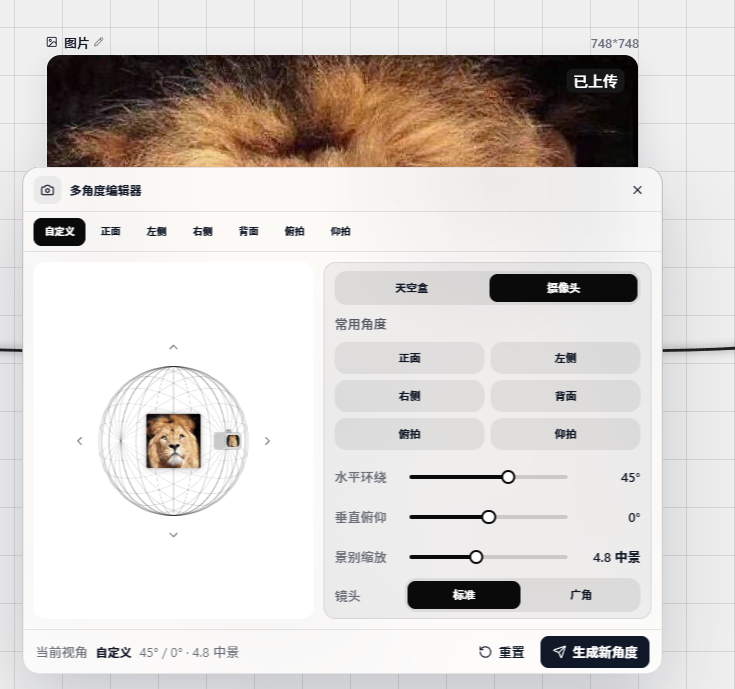 |
| CT-06 | AI 图层拆分 | 图片工具 → AI 图层拆分 | 文本模型规划图层 → 重建背景/前景 → 图层组与合成预览 · 截图：拆图结果图层组 | [ ] | 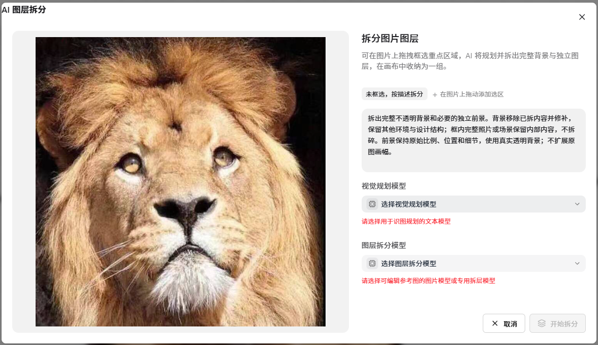 |
| CT-07 | 宫格切分 | 图片工具 → 拆分与标记 → 宫格切分 | 4/9/16/25 预设与 5×5 自定义点选，子图按网格排开 · 截图：宫格切分选择面板 | [ ] | 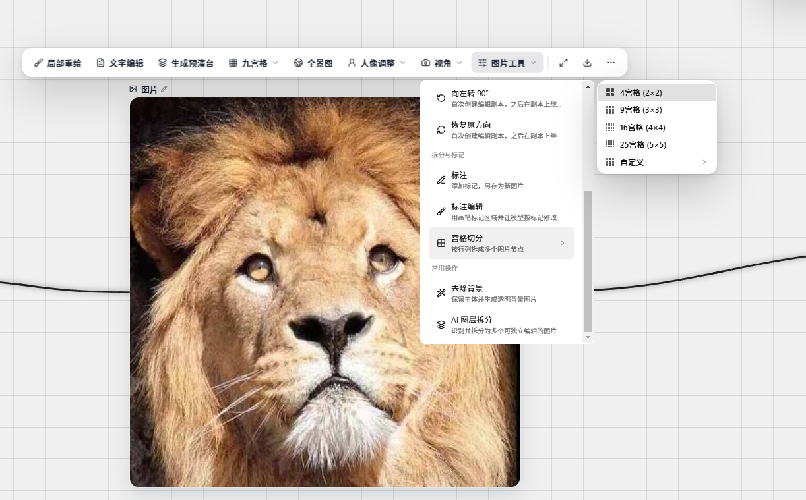 |
| CT-08 | 九宫格生成工具 | 图片工具 → 宫格生成/设定图/画面推演 | 多机位九宫格、三视图、25 宫格分镜、3 秒后/5 秒前推演 · 截图：九宫格工具菜单 | [ ] |  |
| CT-09 | 裁剪 / 调整尺寸 / 方向旋转 | 图片工具 → 构图与尺寸 | 裁剪选区、插值放大、左/右转 90° 生成编辑副本 · 截图：裁剪弹窗或旋转后的双节点 | [ ] |  |
| CT-10 | 提示词放大编辑 | 提示词面板 → 放大 | 约 1200px 可拖拽窗口，编辑区 ≥200px · 截图：放大编辑浮窗 | [ ] |  |
| CT-11 | 风格中心 | 添加节点 → 项目画风 | 系统风格/我的风格/项目快照、搜索、收藏、新建/删除风格 · 截图：风格中心弹窗 | [ ] |  |
| CT-12 | 风格 / 运镜 / 特效预设选择器 | 画布生成工具面板 | 选择后仅加入提示词或创建待生成子节点，不自动发起生成 · 截图：预设选择器面板 | [ ] |  |
| CT-13 | 视频片段与提取 | 视频节点悬浮工具 | 截取片段、提取画面、提取音频为 MP3、合并选中视频 · 截图：片段截取弹窗 | [ ] |  |
| CT-14 | 音频生成 / TTS 设置 | 音频节点设置 | 音色（豆包/渠道 ID）、音频格式、语速 · 截图：音频设置面板 | [ ] |  |
| CT-15 | 智能引用 | 节点提示词面板 | AutoLink 开关、一键引用全文、`图1`/`@` 候选插入 · 截图：提示词输入与候选浮层 | [ ] |  |
| CT-16 | AI 提示词优化器 | 首页或节点提示词 → 优化 | 5 种优化方式、流式反馈、采用后回填并关闭 · 截图：可拖动聊天式优化抽屉 | [ ] |  |
| CT-17 | 画布导出 | `/canvas` 卡片菜单 → 导出画布 | 导出为画布压缩包（含绘图），列表支持批量导出 · 截图：导出菜单与下载提示 | [ ] |  |
| CT-18 | 画布分享弹窗 | 编辑器顶栏 → 分享 | 创建/复制/重新生成/停止分享链接，可选 7/30 天有效 · 截图：分享链接弹窗 | [ ] |  |
| CT-19 | 分享画布访客页 | `/share/canvas/:token` | 免登录只读查看，拖动与临时加节点刷新即恢复 · 截图：访客只读画布 | [ ] |  |
| CT-20 | 画布同步状态与离线恢复 | 编辑器顶栏云图标 | 保存中/已同步/待处理/错误，断网自动重放 journal · 截图：顶栏同步状态图标 | [ ] |  |
| CT-21 | 画布历史抽屉 | `/canvas` → 历史 | 活跃/已删除画布时间线、搜索、清空删除历史 · 截图：右侧历史抽屉 | [ ] |  |
| CT-22 | 导入第三方画布 | 顶栏 → 导入第三方画布 | LibTV / TapNow 分享链接导入节点与连线 · 截图：导入弹窗与结果预览 | [ ] |  |
| CT-23 | 画布任务详情弹窗 | 节点状态 → 任务详情 | 阶段/进度/模型/提示词/参数/日志、取消任务 · 截图：任务详情弹窗 | [ ] |  |
| CT-24 | AI 超分弹窗（占位） | 图片工具 → AI 超分 | 打开后仅显示「暂未实现」 · 截图：弹窗内「暂未实现」 |  | 暂未实现 |
| CT-25 | 团队协作列表 | 短剧制作-项目列表 | 打开后可以查看团队/个人项目 |  |  |
|  |  |  |  |  |  |

### 4.5 导演台 / 3D 预演台（`PV-NN`，15 项）

| ID | 功能点 | 入口 / 宿主 | 说明与截图要点 | 补图 | 截图 |
|---|---|---|---|:---:|---|
| PV-01 | 预演台入口 | 添加节点 → 预演台(3D) / 图片工具 → 生成预演台 / 预演节点双击 | 从画布镜头节点打开导演工作台 · 截图：入口菜单与预演节点卡片 | [ ] |  |
| PV-02 | 镜头模板选择弹窗 | 新建预演台镜头 | 空场景/带演员等模板卡片，显式选择 · 截图：「选择镜头模板」弹窗 | [ ] |  |
| PV-03 | 3D 预演工作台 | 画布内全屏浮层 | 场景面板 + 3D 视口 + 检查器 + 时间轴 · 截图：工作台全屏布局 | [ ] |  |
| PV-04 | 添加对象弹窗 | 场景面板顶部 角色/道具/灯光/机位 | 带预览的选择弹窗，统一添加入口 · 截图：四类对象选择弹窗 | [ ] |  |
| PV-05 | 对象/灯光/镜头检查器 | 右侧检查器 | 变换、体型、外观、姿态、动作、焦段、灯光分组编辑 · 截图：检查器面板 | [ ] |  |
| PV-06 | 道具库 / 主体库 | 工作台道具面板 | 按比例缩略图卡片、可折叠 · 截图：道具库面板 | [ ] |  |
| PV-07 | 序列器与关键帧 | 工作台底部时间轴 | 播放头、姿态动画、运镜路径、关键帧增删 · 截图：时间轴与关键帧行 | [ ] |  |
| PV-08 | 取景模式 3D / CAM | 视口右上取景工具条 | 从自由视角切到镜头摄影机，含安全框 · 截图：取景切换按钮与构图框 | [ ] |  |
| PV-09 | 运镜模板与多视角取景 | 视口 Dock / 检查器 | 焦段+画幅决定取景、常用运镜与景别预设 · 截图：Dock 展开取景细项 | [ ] |  |
| PV-10 | 构图截图与录制 | 工作台顶栏 → 录制 | 镜头画面录制 / 含面板窗口录制、停止录制 · 截图：录制下拉与进行中状态 | [ ] |  |
| PV-11 | 白模 / 深度图 / 深度视频回写 | 工作台顶栏 → 捕捉深度 | 同一镜头摄影机输出并回写为独立画布节点 · 截图：回写成功提示与新节点 | [ ] |  |
| PV-12 | 第二屏监看 | 顶栏 → 第二屏 | 独立窗口显示镜头画面，可全屏 · 截图：监看独立窗口 | [ ] |  |
| PV-13 | 预演台与分镜表双向关联 | 分镜行/预演节点互跳 | 场景 ID 写入分镜行，构图/白模/深度产物回写画布 · 截图：画布上的预演缩略图节点 | [ ] |  |
| PV-14 | 角色参考与角色卡库弹窗 | 画布角色卡 / 项目资产入口 | 角色参考图、三视图、音色绑定与搜索分页 · 截图：角色卡库弹窗 | [ ] |  |
| PV-15 | 章节分镜生产 | 项目详情 → 新建当前章节画布 | 按章节分镜生成画布节点并关联项目 · 截图：新建后自动排布的分镜画布 | [ ] |  |

### 4.6 工作台与任务（`WK-NN`，11 项）

| ID | 功能点 | 入口 / 宿主 | 说明与截图要点 | 补图 | 截图 |
|---|---|---|---|:---:|---|
| WK-01 | 图片工作台 | `/toolbox/image`（默认关闭） | 工具卡片选场景、套预设、配参数与参考图、生成 · 截图：三栏工作台首屏 | [ ] |  |
| WK-02 | 视频工作台 | `/toolbox/video`（默认关闭） | 同一工作台切换视频模型与视频参数 · 截图：视频工作台首屏 | [ ] |  |
| WK-03 | 工具目录与预设弹窗 | 工作台 → 选择创作工具 | 搜索工具、分类、说明与示例素材、提示词模板 chips · 截图：工具选择弹窗 | [ ] |  |
| WK-04 | 生成结果 / 任务 / 历史三栏 | 工作台移动 Tab | 结果网格、任务重试取消、历史详情同页查看 · 截图：结果 Tab 与任务 Tab | [ ] |  |
| WK-05 | 任务中心 | `/tasks`（侧栏「创作历史」） | 列表/网格、状态筛选、按画布分组、搜索 · 截图：任务列表页 | [ ] |  |
| WK-06 | 任务详情抽屉 | 任务行 → 详情 | 状态、参数、日志、重试保存、取消、导出诊断包 · 截图：右侧详情抽屉 | [ ] |  |
| WK-07 | 活跃任务面板 | 画布顶栏下方浮层 | 当前画布进行中生成任务、进度、积分、取消 · 截图：展开的任务浮层 | [ ] |  |
| WK-08 | SSE 流式文本 | 任务/Agent/优化器请求 | `text/event-stream` 增量文本与任务事件回流 |  |  |
| WK-09 | 服务商目录与模型选择 | `ModelPicker` 弹层（首页/画布/设置/Agent） | 跨渠道按模型分组、显示渠道展示名与规格售价 · 截图：模型选择下拉 | [ ] |  |
| WK-10 | 工作台工具管理 | `/admin/workbench-tools` | 分类、图标封面、预设、说明、示例素材、开放状态 · 截图：后台工具列表 | [ ] |  |
| WK-11 | 系统渠道管理 | `/admin/channels` | 渠道/模型/价格档、能力编辑、排序、复制渠道 · 截图：渠道列表与模型管理 | [ ] |  |

### 4.7 素材 / 技能 / 插件（`LB-NN`，16 项）

| ID | 功能点 | 入口 / 宿主 | 说明与截图要点 | 补图 | 截图 |
|---|---|---|---|:---:|---|
| LB-01 | 素材库 | `/assets` | 搜索、业务/我的分类筛选、网格卡片、批量选择 · 截图：素材库首屏 | [ ] |  |
| LB-02 | 素材分类管理 | 素材库左侧 → 新建分类 | 新建/重命名/删除分类、批量移动、未分类归位 · 截图：分类侧栏与新建弹窗 | [ ] |  |
| LB-03 | 批量上传 | 素材库 → 批量上传 | 多文件上传弹窗与分类归属 · 截图：批量上传弹窗 | [ ] |  |
| LB-04 | 回收站 | 素材库 → 回收站 | 移入/还原/彻底删除/清空，保留天数提示 · 截图：回收站视图 | [ ] |  |
| LB-05 | 删除引用保护提示 | 素材 → 彻底删除确认 | 提示旧画布/任务引用可能失效；后台资源清理先查引用 · 截图：删除确认弹窗 | [ ] |  |
| LB-06 | 素材库选择器弹窗 | 画布 → 素材库 / 添加节点 → 素材库 | 分类、搜索、分页、直接插入画布 · 截图：素材选择弹窗 | [ ] |  |
| LB-07 | 资产页容量用量 | 素材库页头 | 已用/总量进度，与侧栏同一查询 · 截图：页头容量卡 | [ ] |  |
| LB-08 | 技能库 | `/skills` | 技能广场/我的技能/我创建的/收藏，搜索与卡片 · 截图：技能库首屏 | [ ] |  |
| LB-09 | 技能详情抽屉 | 技能卡片 → 详情 | 说明、加入/移除我的技能、分类设置 · 截图：右侧详情抽屉 | [ ] |  |
| LB-10 | 技能编辑抽屉 / 安装技能弹窗 | 技能库 → 安装技能 / 编辑技能 | 自建技能、AI 草稿、安装来源 · 截图：编辑抽屉或安装弹窗 | [ ] |  |
| LB-11 | 个人技能分类 | 技能库左侧 → 新建 | 个人/平台范围分类，删除只解除归类 · 截图：分类侧栏与范围选择 | [ ] |  |
| LB-12 | 插件中心 | `/plugins` | 分类、搜索、已启用/可信筛选、启停开关 · 截图：插件卡片墙 | [ ] |  |
| LB-13 | 插件设置与文档弹窗 | 插件卡片 → 设置 / 文档 | 仅显示该插件支持的配置项；Markdown 文档 · 截图：设置抽屉或文档弹窗 | [ ] |  |
| LB-14 | Eagle 外部素材库 | `/plugins/eagle` | 文件夹/标签/关键词/类型查询，写入 Eagle · 截图：Eagle 素材浏览页 | [ ] |  |
| LB-15 | Eagle 插件配置 | 插件中心 → Eagle 设置 | 本地 API 地址、自动归档生成结果、目标文件夹 · 截图：Eagle 配置面板 | [ ] |  |
| LB-16 | 项目资产（角色/场景/道具） | 项目详情 → 角色与资产 / 画布项目资产弹窗 | 待确认资产、绑定素材、生成参考图、插入画布 · 截图：资产卡片与确认弹窗 | [ ] |  |

### 4.8 短剧项目与剪辑成片（`DR-NN`，15 项）

| ID | 功能点 | 入口 / 宿主 | 说明与截图要点 | 补图 | 截图 |
|---|---|---|---|:---:|---|
| DR-01 | 项目列表 | `/projects` | 搜索、排序、状态筛选、项目卡片（章节/画布/资产计数） · 截图：项目卡片网格 | [ ] |  |
| DR-02 | 新建项目与 AI 生成章节 | 项目列表 → 新建 / AI 生成章节 | 一句话生成大纲与章节（章数/篇幅/角色规模） · 截图：AI 生成进度弹窗 | [ ] |  |
| DR-03 | 制作概览 | `/projects/:id/overview` | 制作流程步骤卡、完成度、成片数量 · 截图：概览步骤卡 | [ ] |  |
| DR-04 | 剧情章节 | `/projects/:id/chapters/:chapterId` | 章节富文本、章节导航、AI 提取角色/场景/道具 · 截图：章节编辑器 | [ ] |  |
| DR-05 | 分镜制作工作流 stage | `/projects/:id/workflow/:unitId/:stage` | 按 stage 制作首帧/视频，镜头版本与产物 · 截图：分镜工作区 | [ ] |  |
| DR-06 | 项目画布列表 | `/projects/:id/canvases` | 项目关联画布与新建画布 · 截图：项目画布卡片列表 | [ ] |  |
| DR-07 | 项目设置 | `/projects/:id/settings` | 项目归档/恢复、画风、偏好 · 截图：项目设置表单 | [ ] |  |
| DR-08 | 时间线编辑器 | `/projects/:id/editor`（「剪辑成片」） | 多轨道、片段拖拽/拆分/修剪、播放头定位、胶片条 · 截图：编辑器整屏 | [ ] |  |
| DR-09 | 编辑器预设面板 | 左栏「添加」分类 | 8 个内置片段/字幕插件，按分类接入插槽 · 截图：左栏预设面板 | [ ] |  |
| DR-10 | 字幕转写与 SRT | 左栏「转写」/ 右栏「字幕」 | 发起转写任务生成字幕轨，SRT 导入重分段 · 截图：字幕轨与字幕面板 | [ ] |  |
| DR-11 | 成片渲染导出 | 顶栏 → 导出 / 右栏「导出」 | 服务端 ffmpeg 渲染，成功后概览显示成片数 · 截图：导出面板与进度 | [ ] |  |
| DR-12 | 编辑器撤销/重做与保存状态 | 编辑器顶栏 | 200 层命令历史、状态栏显示轨道/片段数                        |      |                                     |
| DR-13 | AI 编辑助手 | 编辑器顶栏浮层 | 自然语言转命令；>3 条先差异预览再批量执行                    |      |                                     |
| DR-14 | 项目侧栏章节导航 | 关联画布左侧栏 | 章节搜索、拖入画布、定位画风与资产 · 截图：画布内项目侧栏 | [ ] |  |
| DR-15 | 视频节点进入剪辑 | 视频节点工具 → 进入剪辑 | 打开项目时间线并定位到当前素材 · 截图：跳转后的时间线 | [ ] |  |

### 4.9 云端 Agent（需求中暂无,只是看到参考网站有的功能）

| ID | 功能点 | 入口 / 宿主 | 说明与截图要点 | 补图 | 截图 |
|---|---|---|---|:---:|---|
| AG-01 | Agent 浮窗与聊天 UI | 画布右侧浮窗 / 首页 Agent 模式 | 可移动、缩放、偏好恢复；对话、@ 节点、/ 技能 · 截图：Agent 面板与消息流 | [ ] | ![(./项目截图/AG-01.png) |
| AG-02 | Agent 欢迎页 | 首次打开面板 | 选择技能开始、从灵感构思故事、梳理当前画布 · 截图：欢迎页三个快捷入口 | [ ] |  |
| AG-03 | 权限模式 | Agent 设置 → 执行权限 | 只读 / 请求审批 / 自动执行三种模式 · 截图：权限三选一卡片 | [ ] |  |
| AG-04 | 审批预览与确认 | 运行中消息卡片 | 展示目标节点/类型/修改字段/连线两端，批准或拒绝 · 截图：审批卡片 | [ ] |  |
| AG-05 | Agent 设置首页 | 面板 → 设置 | 推理模式、对话模型、上下文、长期偏好、预算 · 截图：设置首页分区 | [ ] |  |
| AG-06 | Skills 技能筛选 | 设置 → Skills / 技能库弹窗 | 我的技能、已启用、按个人/平台分类筛选，挂载预设 · 截图：技能筛选列表 | [ ] |  |
| AG-07 | 个人记忆 | 设置 → 个人记忆 / `/settings?section=agent-memory` | 批准、添加、导入导出、按日/周/月压缩 · 截图：记忆列表 | [ ] |  |
| AG-08 | MCP 与工具（占位） | 设置 → 工具与连接 | 展示云端工具与连接状态，明示自定义 MCP 暂未开放 · 截图：MCP 说明页 | [ ] |  |
| AG-09 | Agent 形象与名称 | `/admin/settings/appearance` → 画布配置 | 助手名称/入口文案/面板标题/欢迎语、Live2D ZIP 导入预览 · 截图：后台画布配置面板 | [ ] |  |
| AG-10 | Agent 画布写入工具 | 审批通过后执行 | 创建/更新节点、连线、分镜脚本行、下一版提示词草稿 · 截图：执行记录与画布变更 | [ ] |  |
| AG-11 | Agent 运行事件流 | 面板消息时间线 | 工具事件、待办计划清单、运行中插话、ask_user 选项 · 截图：事件时间线与待办 | [ ] |  |
| AG-12 | Agent 预算与生成审批 | 设置 → 预算 | 每轮积分/生成任务数/视频秒数上限，媒体先草稿再审批 · 截图：预算输入面板 | [ ] |  |

### 4.10 钱包 / 设置 / 管理后台（`SY-NN`，38 项）

| ID | 功能点 | 入口 / 宿主 | 说明与截图要点 | 补图 | 截图 |
|---|---|---|---|:---:|---|
| SY-01 | 积分中心弹窗 | 账户卡片/顶栏积分/命令面板/画布余额/`/wallet` 回跳 | 充值、兑换、消费记录三 Tab 同一弹窗 · 截图：钱包弹窗首屏 | [ ] |  |
| SY-02 | 在线充值与扫码支付 | 钱包 → 充值 | 充值商品、支付渠道、二维码/跳转支付、查单 · 截图：扫码支付弹窗 | [ ] |  |
| SY-03 | 兑换码兑换 | 钱包 → 兑换 | 32 位卡密输入、确认兑换、购买链接 · 截图：兑换码 Tab | [ ] |  |
| SY-04 | 积分流水 | 钱包 → 消费记录 | 充值/兑换/消费/冻结/退款分页流水 · 截图：流水列表 | [ ] |  |
| SY-05 | 设置页 | `/settings` | 左侧分区导航 + 右侧内容（个人信息/渠道/模型/偏好等） · 截图：设置页整体 | [ ] |  |
| SY-06 | 模型默认网格 | `/settings?section=models` | 按领域选择默认模型 · 截图：模型默认设置面板 | [ ] |  |
| SY-07 | 个人渠道与 RunningHub 工作流 | `/settings?section=channels`、`?section=runninghub` | 自定义渠道 Base URL/Key/模型、云端工作流 · 截图：渠道配置表单 | [ ] |  |
| SY-08 | 提示词偏好 / 生成偏好 | `?section=prompts`、`?section=preferences` | 跟随或改写平台模板、默认生图张数 · 截图：偏好面板 | [ ] |  |
| SY-09 | 问题诊断包导出 | `?section=diagnostics` 或失败任务详情 | 数据量预览 + 脱敏 ZIP 下载 · 截图：诊断面板 | [ ] |  |
| SY-10 | 我的对象存储 | `?section=storage` | 个人媒体存储配置 · 截图：存储配置表单 | [ ] |  |
| SY-11 | 运行总览 | `/admin` | 请求质量、队列与成本趋势 · 截图：后台首页图表 | [ ] |  |
| SY-12 | 请求明细 | `/admin/logs` | 上游调用与费用、导出当前筛选、详情抽屉 · 截图：日志表格 | [ ] |  |
| SY-13 | 系统性能 | `/admin/settings/system-performance` | 主机、数据库、缓存状态 · 截图：性能面板 | [ ] |  |
| SY-14 | 前台模型目录 | `/admin/models`（默认关闭） | 展示、线路与用户价格，模型路由能力 · 截图：模型列表页 | [ ] |  |
| SY-15 | 提示词模板 | `/admin/prompt-templates` | 平台 LLM 任务提示词版本维护 · 截图：模板列表 | [ ] |  |
| SY-16 | 存储资源 | `/admin/resources` | 资源列表、容量、预览、引用保护清理 · 截图：资源表格 | [ ] |  |
| SY-17 | 用户管理 | `/admin/users` | 账号、角色、状态与用户详情抽屉 · 截图：用户表格 | [ ] |  |
| SY-18 | 系统公告 | `/admin/announcements` | 发布/关闭/历史公告 · 截图：公告面板 | [ ] |  |
| SY-19 | 常驻通知 | `/admin/banner-announcements` | 标题分段样式、类型、生效窗口、跳转链接、emoji · 截图：通知编辑面板 | [ ] |  |
| SY-20 | 后台 Agent 记忆 | `/admin/agent-lessons` | 按用户查看/删除个人记忆，不能代批 · 截图：记忆管理面板 | [ ] |  |
| SY-21 | 支付充值与对账 | `/admin/payments` | 订单筛选、CSV 导出、每日对账与异常明细 · 截图：订单表格与对账区 | [ ] |  |
| SY-22 | 积分运营 | `/admin/credit-operations` | 人工调账与异常计费 · 截图：调账面板 | [ ] |  |
| SY-23 | 兑换码 | `/admin/redemption-codes` | 生成与查看兑换码批次 · 截图：批次列表与生成弹窗 | [ ] |  |
| SY-24 | 插件管理 | `/admin/plugins` | 平台可用性、上传与卸载 · 截图：插件管理表格 | [ ] |  |
| SY-25 | 技能分类策展 | `/admin/skill-curation` | 平台子分类维护（默认关闭可开启） · 截图：策展面板 | [ ] |  |
| SY-26 | 站点及外观 | `/admin/settings/appearance` | 品牌、登录页、SEO/备案、皮肤主题、更新公告、画布 Agent 配置 · 截图：外观配置页 | [ ] |  |
| SY-27 | 功能开放 | `/admin/settings/features` | 全部功能开关与前台模型目录来源切换 · 截图：开关面板 | [ ] |  |
| SY-28 | 绘图工具 | `/admin/settings/drawing-engine` | 画布绘图节点默认引擎 · 截图：设置表单 | [ ] |  |
| SY-29 | 资源与策略 | `/admin/settings/runtime-policy` | 配额、并发、频控、超时、闲置清理 · 截图：策略表单 | [ ] |  |
| SY-30 | 登录与注册 | `/admin/settings/access` | 账号创建、第三方登录、注册频控 · 截图：访问设置面板 | [ ] |  |
| SY-31 | 邮件服务 | `/admin/settings/email` | 注册验证码与 SMTP、发件人继承站点名 · 截图：邮件配置面板 | [ ] |  |
| SY-32 | 存储服务 | `/admin/settings/storage` | 对象存储与资源存储配置 · 截图：存储配置表单 | [ ] |  |
|       |                              |                                                     |                                                              |      |                                     |
|       |                              |                                                     |                                                              |      |                                     |
| SY-35 | 第三方参数配置 | `/admin/settings/third-party` | LibTV 等凭据配置后开放用户入口 · 截图：第三方配置页 | [ ] |  |
| SY-36 | 系统更新与公告 | `/admin/settings/system-update` | 版本检查、备份、安全更新、自定义更新公告 · 截图：系统更新页 | [ ] |  |
|       |                              |                                                     |                                                              |      |                                     |
|       |                              |                                                     |                                                              |      |                                     |

### 4.11 团队协作

| ID    | 功能点       | 入口 / 宿主  | 说明与截图要点                                               | 补图 | 截图                                |
| ----- | ------------ | ------------ | ------------------------------------------------------------ | :--: | ----------------------------------- |
| TD-01 | 团队成员列表 | 左侧菜单栏   | 列表页,对团队成员的增删改查                                  | [ ]  |                                     |
| TD-02 | 团队         | 首次打开面板 | 选择技能开始、从灵感构思故事、梳理当前画布 · 截图：欢迎页三个快捷入口 | [ ]  |  |